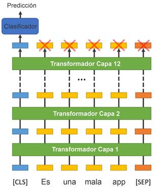

# Sentiment Analysis and Emotion Classification with Transformers & DistilBERT

### Natural Language Processing, Transfer Learning, Text Classification, and Deep Learning with Python

<div align="center">



*Natural Language Processing — Exploring sentiment and emotion recognition using Transformers, DistilBERT, and Python.*

</div>

**Project Type:** Educational Natural Language Processing and Deep Learning  
**Field:** Artificial Intelligence | Natural Language Processing | Machine Learning | Text Classification  
**Programming Language:** Python  
**Environment:** Google Colab | Jupyter Notebook  
**Author:** Data Engineer Luis Barahona

---

## 1. Project Overview

This project explores sentiment analysis and emotion classification using Python, Hugging Face Transformers, and DistilBERT.

The notebook investigates how pretrained language models can be used to analyze text and identify sentiment polarity or emotional categories.

The work combines practical experiments and educational material covering:

- Text preprocessing and dataset exploration.
- Pretrained sentiment analysis pipelines.
- Tokenization using Hugging Face Tokenizers.
- Transformer-based feature extraction.
- Dimensionality reduction and visualization.
- Classification using logistic regression.
- Fine-tuning DistilBERT for emotion classification.
- Model evaluation using accuracy, F1-score, and confusion matrices.
- Prediction error analysis.
- PyTorch and TensorFlow training approaches.

The notebook contains two related but distinct tasks: sentiment classification and emotion recognition.

The extended emotion-classification material follows examples from the book *Natural Language Processing with Transformers* and its associated educational repository.

---

## 2. Project Objectives

The main objectives are to:

1. Understand the fundamentals of Natural Language Processing.
2. Explore text classification using pretrained Transformer models.
3. Load and preprocess labeled social media datasets.
4. Analyze sentiment polarity in text.
5. Understand tokenization and attention masks.
6. Extract contextual embeddings using DistilBERT.
7. Visualize high-dimensional text representations.
8. Establish machine learning classification baselines.
9. Fine-tune a pretrained Transformer model.
10. Evaluate multiclass emotion predictions.
11. Investigate classification errors.
12. Explore model inference and deployment possibilities.

---

## 3. Understanding Sentiment Analysis

Sentiment analysis attempts to identify the emotional polarity or evaluative orientation expressed in text.

A typical binary sentiment classifier predicts:

- Positive
- Negative

More detailed sentiment datasets may include:

- Positive
- Negative
- Neutral
- Irrelevant

These categories describe different relationships between text and the subject being discussed.

The notebook initially explores a pretrained model that distinguishes positive and negative sentiment.

It subsequently introduces a four-class Twitter sentiment dataset.

---

## 4. Understanding Emotion Classification

Emotion classification differs from binary sentiment analysis.

Instead of identifying only positive or negative polarity, an emotion classifier attempts to recognize specific emotional categories.

The notebook uses six emotion classes:

| Class | Emotion |
|:---:|:---|
| 0 | Sadness |
| 1 | Joy |
| 2 | Love |
| 3 | Anger |
| 4 | Fear |
| 5 | Surprise |

These categories belong to the educational emotion dataset used in the notebook.

The objective is to classify English text according to its associated emotion label.

These labels are dataset annotations, not clinical assessments of a person's psychological state.

---

## 5. Datasets

### 5.1 Twitter Sentiment Dataset

The initial experiment loads two CSV files:

```text
twitter_training.csv
twitter_validation.csv
```

### Data Structure

| Column | Description |
|:---|:---|
| id | Record identifier |
| entity | Entity or topic mentioned |
| label | Sentiment category |
| text | Text content |

### Saved Dataset Information

The notebook reports 74,682 records in the original training CSV.

The text field contains 73,996 non-null entries before cleaning.

The preprocessing workflow removes duplicate rows and missing observations.

It also converts the text to lowercase.

The four sentiment labels are:

- Positive
- Negative
- Neutral
- Irrelevant

### 5.2 Hugging Face Emotion Dataset

The second major experiment uses:

```python
from datasets import load_dataset

emotions = load_dataset("emotion")
```

### Dataset Structure

| Split | Records |
|:---|---:|
| Training | 16,000 |
| Validation | 2,000 |
| Testing | 2,000 |
| **Total** | **20,000** |

Each observation contains:

- Text.
- Emotion label.

This dataset supports the six-class emotion classification experiments.

---

## 6. Data Preprocessing

### Twitter Sentiment Data

The notebook applies:

- CSV loading.
- Column renaming.
- Missing-value removal.
- Duplicate removal.
- Text normalization.
- Label conversion.

Example:

```python
df_train.drop_duplicates(inplace=True)
df_valid.drop_duplicates(inplace=True)

df_train.dropna(inplace=True)
df_valid.dropna(inplace=True)

df_train["text"] = df_train["text"].str.lower()
df_valid["text"] = df_valid["text"].str.lower()
```

### Label Encoding

The four-class experiment defines:

```python
label_map = {
    "Positive": 0,
    "Negative": 1,
    "Neutral": 2,
    "Irrelevant": 3
}
```

These labels are converted into numerical categories for training.

### Important Limitation

The original notebook repeats portions of the label-encoding and training workflow.

Repeatedly applying the same mapping to already encoded labels can introduce missing values.

This section should be consolidated before attempting reproducible four-class fine-tuning.

---

## 7. Pretrained DistilBERT Sentiment Analysis

The first sentiment experiment uses:

```text
distilbert-base-uncased-finetuned-sst-2-english
```

This checkpoint is a pretrained DistilBERT model fine-tuned for binary sentiment classification.

### Model Loading

```python
from transformers import (
    AutoTokenizer,
    AutoModelForSequenceClassification,
    pipeline
)

model_name = (
    "distilbert-base-uncased-"
    "finetuned-sst-2-english"
)

tokenizer = AutoTokenizer.from_pretrained(
    model_name
)

model = AutoModelForSequenceClassification.from_pretrained(
    model_name
)
```

### Sentiment Pipeline

```python
sentiment_pipeline = pipeline(
    "text-classification",
    model=model,
    tokenizer=tokenizer
)
```

### Sample Predictions

The notebook applies the pretrained model to sample tweets and displays:

- Original text.
- Predicted sentiment.
- Model confidence score.

### Evaluation Limitation

The pretrained SST-2 checkpoint predicts only:

- POSITIVE
- NEGATIVE

The Twitter dataset contains four categories.

The notebook attempts to compare these predictions with all four dataset labels without using a compatible evaluation procedure.

The saved full-validation cell produces an error.

Therefore, no validated four-class accuracy should be reported for this pretrained binary sentiment model.

---

## 8. Four-Class DistilBERT Fine-Tuning

The notebook prepares an additional experiment using:

```text
distilbert-base-uncased
```

The model is configured with four output labels.

### Model Configuration

```python
model = (
    AutoModelForSequenceClassification
    .from_pretrained(
        "distilbert-base-uncased",
        num_labels=4
    )
)
```

### Training Configuration

The notebook includes:

| Parameter | Value |
|:---|:---|
| Epochs | 3 |
| Training batch size | 8 |
| Evaluation batch size | 8 |
| Learning rate | 2e-5 |
| Weight decay | 0.01 |

The training pipeline uses Hugging Face Trainer.

### Recorded Execution Status

The saved training attempt is interrupted by a Weights & Biases authentication prompt.

A completed four-class model evaluation is not demonstrated in this section.

Consequently, the experiment should be described as a configured but incomplete training workflow.

---

## 9. DistilBERT Architecture

DistilBERT is a smaller Transformer model derived from BERT through knowledge distillation.

It is designed to provide more efficient language representations while preserving much of the predictive capability of larger Transformer models.

### Main Concepts

The notebook explores:

- Transformer encoders.
- Contextual embeddings.
- Tokenization.
- Attention masks.
- Hidden states.
- Transfer learning.
- Sequence classification.

### Tokenizer Properties

The saved notebook reports:

| Property | Value |
|:---|---:|
| Vocabulary size | 30,522 |
| Maximum sequence length | 512 tokens |
| Hidden-state dimension | 768 |

These properties correspond to the pretrained DistilBERT configuration used in the educational examples.

---

## 10. Tokenization

Transformers process numerical token IDs rather than raw text.

Tokenization converts a sentence into a representation compatible with the pretrained model.

### Example

```python
from transformers import AutoTokenizer

tokenizer = AutoTokenizer.from_pretrained(
    "distilbert-base-uncased"
)

text = "Tokenizing text is a core task of NLP."

encoded = tokenizer(text)

print(encoded)
```

The model input includes:

- input_ids
- attention_mask

### Special Tokens

The notebook explores special tokens such as:

```text
[CLS]
[SEP]
[PAD]
```

These tokens help represent sentence boundaries and padding.

### Dataset Tokenization

The emotion dataset is transformed using:

```python
def tokenize(batch):
    return tokenizer(
        batch["text"],
        padding=True,
        truncation=True
    )

emotions_encoded = emotions.map(
    tokenize,
    batched=True
)
```

The resulting dataset includes token IDs and attention masks for model inference and training.

---

## 11. Transformer Feature Extraction

The notebook explores using a pretrained Transformer as a feature extractor.

Instead of immediately fine-tuning the complete model, it extracts contextual hidden-state representations from the input text.

### Feature Extraction

The hidden representation associated with the first token is used as a text feature vector.

The experiment generates:

```text
Training features:   (16000, 768)
Validation features: (2000, 768)
```

This produces 768-dimensional representations of the input texts.

### Purpose

These features can be used with traditional machine learning classifiers.

The experiment demonstrates an alternative to end-to-end Transformer fine-tuning.

---

## 12. Dimensionality Reduction with UMAP

The notebook uses Uniform Manifold Approximation and Projection (UMAP) to visualize Transformer embeddings.

### Workflow

1. Extract DistilBERT hidden states.
2. Normalize the feature representations.
3. Apply UMAP.
4. Reduce the representations to two dimensions.
5. Visualize observations by emotion category.

### Objective

The visualization helps explore whether different emotions occupy distinguishable regions of the learned representation space.

UMAP is used for exploratory visualization, not as proof that all emotion classes can be perfectly separated.

---

## 13. Baseline Classification

The notebook compares two traditional machine learning approaches using Transformer embeddings.

### Logistic Regression

A logistic regression classifier is trained on the extracted DistilBERT features.

### Majority-Class Baseline

A DummyClassifier predicts the most frequent training class.

This provides a simple benchmark.

### Saved Validation Results

| Model | Validation Accuracy |
|:---|---:|
| Majority-class baseline | 35.20% |
| DistilBERT features + Logistic Regression | 60.85% |

### Interpretation

Using contextual embeddings substantially improves classification accuracy over the majority-class baseline in the saved experiment.

However, the logistic regression execution also records a convergence warning, which should be considered when interpreting the result.

---

## 14. Fine-Tuning DistilBERT for Emotion Classification

The extended educational workflow fine-tunes DistilBERT directly for six emotion categories.

### Model

```python
from transformers import (
    AutoModelForSequenceClassification
)

model = (
    AutoModelForSequenceClassification
    .from_pretrained(
        "distilbert-base-uncased",
        num_labels=6
    )
)
```

### Training Configuration

| Parameter | Value |
|:---|---|
| Model | DistilBERT |
| Number of classes | 6 |
| Epochs | 2 |
| Batch size | 64 |
| Learning rate | 2e-5 |
| Weight decay | 0.01 |
| Framework | PyTorch |
| Training API | Hugging Face Trainer |

### Saved Evaluation Results

| Metric | Value |
|:---|---:|
| Validation accuracy | 92.25% |
| Weighted F1-score | 0.9226 |
| Validation loss | 0.2205 |

These values appear in the notebook's saved educational example outputs.

They should not be interpreted as independently reproduced results from a newly executed experiment.

### Interpretation

The fine-tuned DistilBERT model achieves higher validation accuracy than the logistic regression classifier trained on frozen embeddings.

This demonstrates the potential benefit of adapting pretrained Transformer parameters to a specific classification task.

---

## 15. TensorFlow and Keras Experiment

The notebook also explores fine-tuning Transformers with TensorFlow.

The experiment uses:

- TFAutoModelForSequenceClassification.
- TensorFlow datasets.
- Keras optimization.
- Sparse categorical cross-entropy.
- Two training epochs.

### Saved Training Outputs

The second epoch reports approximately:

| Metric | Value |
|:---|---:|
| Training accuracy | 94.15% |
| Validation accuracy | 93.35% |
| Validation loss | 0.1512 |

These figures come from an older saved execution environment.

The TensorFlow section also records environment-specific GPU library warnings.

The results are included as part of the educational comparison rather than as independently validated benchmarks.

---

## 16. Model Evaluation and Error Analysis

The notebook includes additional tools for investigating classification behavior.

### Confusion Matrix

Confusion matrices compare predicted emotion labels with reference labels.

They help identify pairs of classes that the model may confuse.

### Accuracy

Accuracy measures the proportion of correctly classified observations.

### F1-Score

F1 combines precision and recall into a single metric.

The notebook uses weighted F1 for multiclass evaluation.

### Prediction Loss

The notebook calculates loss values for individual validation observations.

These values are used to identify examples where the model performs poorly.

### Error Analysis

Potential causes of errors include:

- Ambiguous emotional expressions.
- Incorrect or inconsistent labels.
- Limited contextual information.
- Unusual words or text formatting.
- Overlapping emotional categories.

This analysis demonstrates why reviewing individual predictions is important in addition to aggregate metrics.

---

## 17. Model Inference

The final educational example demonstrates emotion classification using a Hugging Face pipeline.

Example:

```python
from transformers import pipeline

model_id = (
    "transformersbook/"
    "distilbert-base-uncased-finetuned-emotion"
)

classifier = pipeline(
    "text-classification",
    model=model_id
)
```

A sample text is classified, and the predicted scores are visualized.

### Model Attribution

The checkpoint above is hosted under the external `transformersbook` namespace.

It is a third-party educational model and should not be described as an independently published model from this repository.

The notebook also contains saved Hugging Face Hub output associated with an external account.

These historical outputs do not establish ownership of that model or repository.

---

## 18. Technologies Used

| Technology | Purpose |
|:---|:---|
| Python | Programming language |
| PyTorch | Deep learning |
| TensorFlow / Keras | Alternative training framework |
| Hugging Face Transformers | Pretrained language models |
| Hugging Face Datasets | Dataset loading and processing |
| Hugging Face Tokenizers | Text tokenization |
| DistilBERT | Transformer language model |
| Scikit-learn | Baseline classification and metrics |
| Logistic Regression | Embedding-based classification |
| UMAP | Dimensionality reduction |
| Pandas | Data processing |
| NumPy | Numerical calculations |
| Matplotlib | Visualization |
| Google Colab | Notebook execution |
| Jupyter Notebook | Interactive development |

---

## 19. How to Run

### Google Colab

[Open the Original Notebook](https://colab.research.google.com/drive/1EFVlBd6neTaydn0nWRi7oJON2kv_jvdI)

### Install Core Dependencies

```bash
pip install torch transformers datasets accelerate scikit-learn pandas numpy matplotlib umap-learn
```

The optional TensorFlow sections require an additional compatible TensorFlow installation.

### Required Files for the Twitter Experiment

```text
twitter_training.csv
twitter_validation.csv
```

Upload both files before executing the initial sentiment analysis cells.

### Emotion Dataset

The second experiment loads its dataset from Hugging Face:

```python
emotions = load_dataset("emotion")
```

An internet connection is required to retrieve the dataset and pretrained checkpoints when they are not cached.

### Execution Recommendations

1. Open the notebook.
2. Install compatible dependencies.
3. Upload the Twitter CSV files for the initial experiment.
4. Explore pretrained sentiment classification.
5. Review the four-class fine-tuning section and its limitations.
6. Load the Hugging Face emotion dataset.
7. Perform tokenization.
8. Extract DistilBERT embeddings.
9. Train the logistic regression baseline.
10. Review UMAP visualizations.
11. Fine-tune a six-class emotion model in a compatible environment.
12. Evaluate accuracy, F1-score, and confusion matrices.
13. Explore inference on new English text.

### Environment Considerations

Some notebook examples use older Hugging Face APIs and saved training environments.

Current versions may require changes to:

- TrainingArguments.
- Dataset formatting.
- Trainer configuration.
- Model authentication.
- TensorFlow compatibility.
- Visualization utilities.

Disable automatic model publishing when reproducing the educational workflow unless publication is explicitly intended.

---

## 20. Limitations

### Multiple Experiments in One Notebook

The notebook combines a custom Twitter sentiment workflow with extensive educational emotion-classification material.

### Source Attribution

Many sections are derived from the educational examples associated with *Natural Language Processing with Transformers*.

### Incompatible Sentiment Labels

A binary SST-2 classifier cannot directly evaluate all four Twitter sentiment classes without an appropriate task-specific mapping or model.

### Incomplete Four-Class Training

The four-class fine-tuning experiment does not contain a verified completed evaluation.

### Historical Saved Outputs

Several saved results originate from an earlier educational execution environment.

They should not be treated as current independent benchmarking.

### English-Language Focus

The models and datasets are primarily designed for English text.

### Dataset Bias

The classification models may reflect label inconsistencies and biases present in the training data.

### Emotion Interpretation

Predicted emotion labels reflect statistical patterns in text.

They do not establish a person's true internal emotional or clinical state.

### Model Generalization

Validation accuracy on a benchmark dataset does not guarantee equivalent performance on other domains or languages.

---

## 21. Future Improvements

Potential developments include:

- Separating sentiment analysis and emotion classification into independent notebooks.
- Correcting the four-class sentiment evaluation.
- Consolidating repeated preprocessing cells.
- Updating deprecated Hugging Face APIs.
- Reproducing model training in a clean environment.
- Recording model versions and random seeds.
- Adding independent test-set evaluation.
- Comparing additional Transformer architectures.
- Implementing multilingual sentiment analysis.
- Evaluating inference latency.
- Improving class imbalance analysis.
- Creating a simple inference API.
- Building an interactive sentiment analysis application.

---

## 22. Practical Applications

The techniques explored in this notebook may support:

- Customer feedback analysis.
- Social media research.
- Review classification.
- Customer support categorization.
- Brand sentiment monitoring.
- Document classification.
- Conversational analytics.
- NLP research and education.

Operational applications would require task-specific datasets, evaluation, and appropriate safeguards.

---

## 23. References and Attribution

### Google Colab Notebook

[Open Sentiment and Emotion Classification Notebook](https://colab.research.google.com/drive/1EFVlBd6neTaydn0nWRi7oJON2kv_jvdI)

### Natural Language Processing with Transformers

**Authors:** Lewis Tunstall, Leandro von Werra, and Thomas Wolf.

**Publisher:** O'Reilly Media.

[Book and Companion Notebooks](https://github.com/nlp-with-transformers/notebooks)

Several sections of this project follow the book's text-classification chapter and its associated code examples.

The original book material, figures, code, and example outputs remain attributable to their respective authors and publishers.

This repository documents study and experimentation using those educational resources.

### Hugging Face

[Transformers Documentation](https://huggingface.co/docs/transformers/)

[Datasets Documentation](https://huggingface.co/docs/datasets/)

### DistilBERT Research Paper

[DistilBERT: A Distilled Version of BERT](https://arxiv.org/abs/1910.01108)

### PyTorch

[PyTorch Documentation](https://pytorch.org/docs/stable/)

---

## 24. Conclusion

This notebook explores fundamental and advanced Natural Language Processing concepts using Transformers and DistilBERT.

The experiments demonstrate how pretrained models can be applied to sentiment analysis, how contextual text embeddings can support traditional machine learning, and how fine-tuning can adapt Transformers to multiclass emotion classification.

The saved educational benchmark reports 92.25% validation accuracy for the fine-tuned six-class DistilBERT model.

The initial four-class sentiment experiment remains incomplete and requires correction before its performance can be assessed reliably.

Overall, this notebook provides an educational foundation for further work in text analytics, deep learning, Transformer architectures, model evaluation, and responsible AI development.

---

## Author

**Data Engineer Luis Barahona**

Mexican Data Engineer and 2026 graduate of Universidad del Caribe, interested in Data Engineering, Data Science, Artificial Intelligence, Natural Language Processing, Machine Learning, and continuous professional development.

---

## Contact

| Platform | Contact |
|:---|:---|
| Email | [190300395@ucaribe.edu.mx](mailto:190300395@ucaribe.edu.mx) |
| GitHub | [github.com/LuisBarahonaMX](https://github.com/LuisBarahonaMX) |
| LinkedIn | [linkedin.com/in/luis-barahona-mx](https://www.linkedin.com/in/luis-barahona-mx/) |
| Instagram | [@luisbarahonamx](https://www.instagram.com/luisbarahonamx/) |
| X | [@luisbarahonaMX](https://x.com/luisbarahonaMX) |
| Website | [SIKO AI Platform](https://sikoai.web.app/) |
